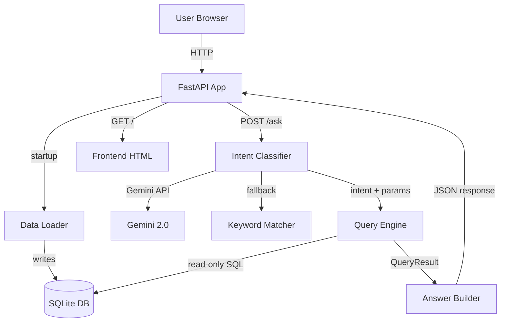

# Architecture

## Component Diagram

## Storage Layout

### Tables

**sales_raw** — All 51 rows from CSV verbatim (no validation)

**sales** — 48 valid, cleaned rows with computed columns:
- `order_date_iso` (YYYY-MM-DD)
- `month` (YYYY-MM)
- `revenue` (Quantity × Unit_price − Discount_amount)

**rejected_rows** — 3 invalid rows with rejection reasons:
- TXN0033: returned
- TXN0034: quantity_zero
- TXN0051: missing_price

### Query Path

1. **Startup**: `data_loader.init_db()` drops all tables, recreates them, loads CSV
2. **Classification**: `intent_classifier.classify()` calls Gemini API (or keyword matcher fallback)
3. **Validation**: Intent and params validated against whitelist (products, regions, months from DB)
4. **Execution**: `query_engine.execute()` runs parameterized SQL on read-only connection
5. **Answer Generation**: `answer_builder.build()` produces human-readable text from query results

## Security

- **Parameterized SQL only** — no string concatenation with user input
- **Read-only DB connection** — `sqlite3.connect("file:...?mode=ro", uri=True)`
- **SQL injection guard** — rejects questions containing DML/DDL keywords
- **Whitelist validation** — all params checked against actual data values
- **No LLM-generated numbers** — answers built from computed SQL results only
